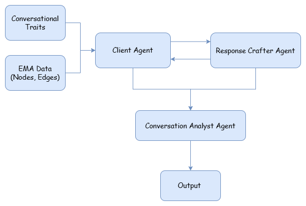

# PTSD Simulation

## What it simulates
A clinical conversation between a virtual PTSD patient and an AI conversational bot, followed by automated analysis of the conversation using Ehlers & Clark's cognitive model of PTSD.

---

## Components

### Data Layer (`data/input.py`)
- Loads real patient data from an Excel file
- Each row represents a patient session with scored PTSD components (**nodes**) and relationships between them (**edges**), based on Ehlers & Clark's cognitive model

### Agents

| Agent | Role |
|---|---|
| `ClientAgent` | Plays the PTSD patient. Driven by patient data (active nodes/edges) and a conversation pattern |
| `ResponseCrafterAgent` | Plays the therapist. Conducts an EMA (Ecological Momentary Assessment) interview |
| `AnalystAgent` | Reads the transcript after the conversation and scores which components were expressed |

**ClientAgent** personality is defined by two things:
- **Patient data** — which nodes (Triggers, Memory, Threat, Negative Appraisals, Maladaptive Strategies) are active and which edges connect them
- **Conversation pattern** — emotion, intensity, expressiveness, disclosure, politeness, assertiveness

---

## Conversation Flow

```
Bot: "Hello, how are you?"
  → Patient responds (driven by their node/edge scores)
  → Bot asks a follow-up question
  → repeat N turns
  → Analyst scores the full transcript
```

---

## Output (`data/output/conversation_X.json`)

Each run produces a JSON file containing:

- Patient metadata (id, schedule, node/edge scores from data)
- Conversation pattern used
- Full conversation transcript
- **Analysis**: binary scores (0/1) for each node and edge observed in the conversation, with quotes and reasoning

---

## Usage

```python
from simulation.runner import SimulationRunner

# Fully sampled run
runner = SimulationRunner(num_patients=5, num_turns=10, model="gpt-4o-mini", seed=42)

# Specific patient, row, and pattern
runner = SimulationRunner(
    num_patients=1,
    num_turns=10,
    model="gpt-4o-mini",
    seed=42,
    subnums=[1],
    row_index=0,
    conversation_pattern={
        "emotion": "anxious",
        "intensity": "severe",
        "expressiveness": "low",
        "disclosure": "low",
        "politeness": "formal",
        "assertiveness": "high"
    }
)

runner.run()
```

To explore available patients and sessions:

```python
from data.input import get_available_subnums, get_patient_rows

print(get_available_subnums())   # list of all patient IDs
print(get_patient_rows(1))       # available rows for patient 1
```

---

## What varies across simulations

| Parameter | Sampled (default) | Fixed |
|---|---|---|
| Patient | Random from dataset | `subnums=[...]` |
| Session row | Random row for that patient | `row_index=N` |
| Conversation pattern | Randomly sampled | `conversation_pattern={...}` |
| Randomness | Controlled by `seed` | — |
